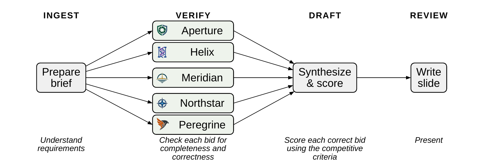

# A*STAR Leadership Retreat AI tutorial

AI tutorial with Dr. Gaurav Manek. [Connect on LinkedIn](https://www.linkedin.com/in/gauravmanek/).

Open a GitHub Codespace, wait for setup, then open Claude Code, sign in with your own account and start a new chat. You supply your own Claude access; no workshop key is included. For an optional personal provider configuration, see [.course/README.md](.course/README.md).

For feedback, questions or problems, type `/tell-gaurav` followed by your message.

## Procurement: a first run [20 minutes]

Five suppliers bid for a research test platform; `case/` contains 47 PDFs. Continue in the same chat through these bounded tasks.

### Understand the case

Start with: `Explain the procurement case to me in plain language.`

Optional follow-ups:

- **Specify target audience:** `Explain this case in two sentences for our finance director.`
- **Specify a structure:** `Explain what we are buying, why we need it, and what the different documents cover.`
- **Explain unfamiliar terminology:** `Explain what an encabulator does to someone without a technical background. Use an analogy.`

### Make a procurement brief

1. **Identify the sources:** `Which documents specify the requirements and criteria?`
2. **Develop the prompt:** `Write a prompt for another agent to turn these documents into a procurement brief in BRIEF.md.` Preserve the source inventory, mandatory gates, scored criteria/weights, budget, delivery/support constraints, source locations and unresolved questions.
3. **Run it:** `Run an agent with that prompt. Don't let it read submitted bids and earlier evaluation results.`

Why keep bids out of the brief-writing agent's inputs? We'll return to this after governance.

### Make something useful

**Make a presentation:** `/pptx Make a three-slide presentation using the A*STAR template explaining this procurement: what we need, how we will evaluate the bids, and the questions still to resolve.`

**Also try:** `Include a pie chart showing the weights of the scored evaluation criteria. Label each slice with its percentage.`

Open the exported PDF and check its sources. The chart covers scored criteria; mandatory gates are separate.

### Optional: check a claim from the slides

`/slides Find the "A convincing recommendation" slide. Check the five errors identified against the original case documents, and tell me what the correct answers are.`

`/slides` supplies the course slides. Bid and evaluation access starts after the brief is saved. Inspect the cited evidence.

### Understand `/usage` and `/context`

`/usage` shows consumption; `/context` shows conversation space. Before compacting or changing chats, save requirements in `BRIEF.md`, policies in `AGENT-DESIGN.md` and bid findings with evaluation outputs. Keep bid findings out of the brief.

## Set policies for a procurement agent [30 minutes]

Your technical team proposes this workflow. Use IMDA to choose policies and human review points.

Ingest prepares the brief; Verify checks each bidder separately; Draft scores eligible bids; Review presents the recommendation.

### Choose a Verify risk and manage it

Continue in the same chat. `/imda-ai` gives your agent the IMDA framework.

1. **Revisit the brief:** `/imda-ai Why is it important to write the procurement brief without access to the bids?`
2. **Understand the boundary:** `/imda-ai Why use a separate agent to verify each bidder?`
3. **Find remaining risks:** `Assume each verifier has a correct BRIEF.md and access to only its assigned bid. What other risks remain? Use /imda-ai.`
4. **Choose one risk:** `Help me develop a control for [chosen risk]. Offer 2–3 options with tradeoffs, and guide me to choose the policy.` Replace the placeholder.
5. **Record your decisions:** `Save our agreed Verify policy and risk assessment in AGENT-DESIGN.md. Flag undecided points and mark untested controls as proposed.`
6. **Present:** `/pptx Present the risk assessment for Verify using the A*STAR template. Include risks, controls, residual risk, owners and tests. Flag gaps.` Open the PDF; trace one row to your assessment.

Optional follow-ups:

- **Probe the failure:** `How could a verifier incorrectly pass a bid?`
- **Help make the decision:** `Interview me like a senior executive and use my responses to craft the policy.`

Separate contexts help avoid mixing bids. Technical controls must enforce access limits; prompts alone cannot.

### Record the policy and risk assessment

In `AGENT-DESIGN.md`, specify **access/tools and enforcement; permitted/prohibited actions; approvers and evidence; stops, escalation and resumption; evidence-log location and contents**.

For your chosen consequential risk, rate severity, likelihood and residual risk Low/Medium/High, with reasons. Name the accountable human; mark untested controls as proposed.

| Risk / failure | Business impact | Severity | Likelihood | Control | Residual risk | Human owner | Test / evidence |
| --- | --- | --- | --- | --- | --- | --- | --- |
| [Failure] | [Impact] | [Before controls] | [Before controls] | [Control + enforcement] | [After controls] | [Owner] | [Planned / observed] |

### Optional: develop a mitigation test

`Would my mitigation catch any of the errors in /slides "A convincing recommendation"? Explain how.`

If none fits: `Propose a concrete error that my mitigation would catch.` Specify input, expected result and evidence. This proposes a test, not a demonstrated success.

### Optional: run the evaluation

First check `/procurement-ingest-check`. With your design ready: `Process the bids using the agent in AGENT-DESIGN.md.`

Built-in subagents run Verify → Draft → Review, with one verifier per bidder; no orchestration code or direct API calls. The run uses `BRIEF.md` without rerunning Ingest. If missing, the agent pauses for you to generate it through the earlier exercise, excluding bids and prior evaluations. The run may take 15 minutes; the agent explains this and waits for confirmation.

Afterwards: `Adversarially review the agent and recommendation against the original sources and /imda-ai.` Inspect each finding's evidence.

### Optional: extend and review the design

Extend policies to other stages, then try `/risk-assessment Analyze my risk assessment in AGENT-DESIGN.md.` It checks all four stages; gaps beyond Verify are expected. It saves questions in `RISK-REVIEW.md`, offering worked answers after 3–4 unsuccessful attempts per issue.

## ATLAS

The instructor presents IMCB's AI business-intelligence platform as governance in practice. No hands-on task; ask follow-ups with `/slides`.

---

All people, organisations, products, rules, and events in this case are fictional and supplied for training.
